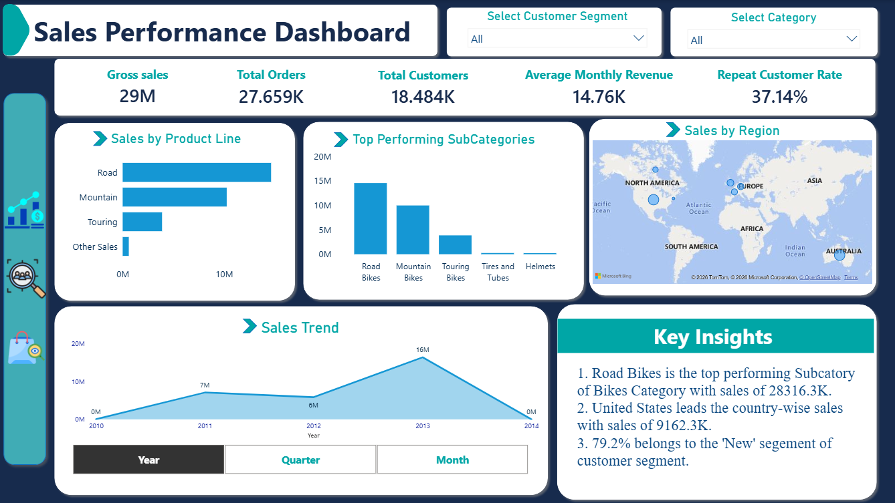
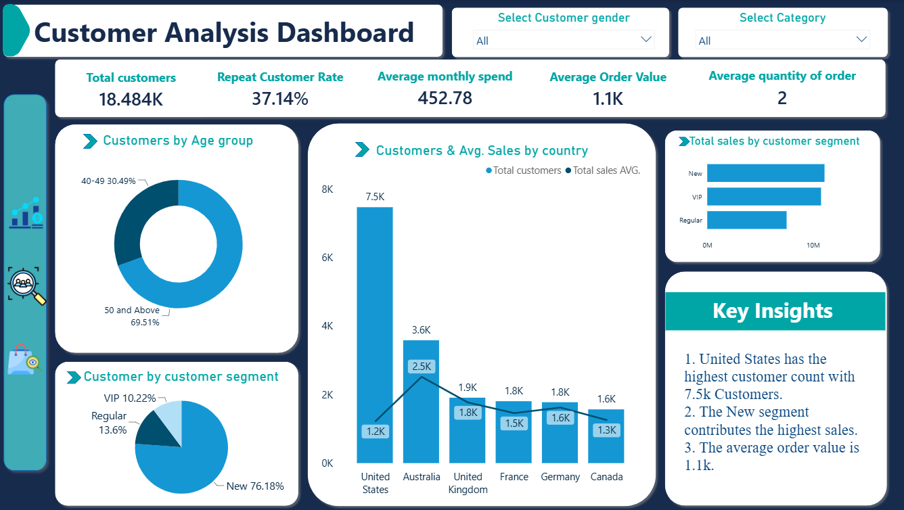
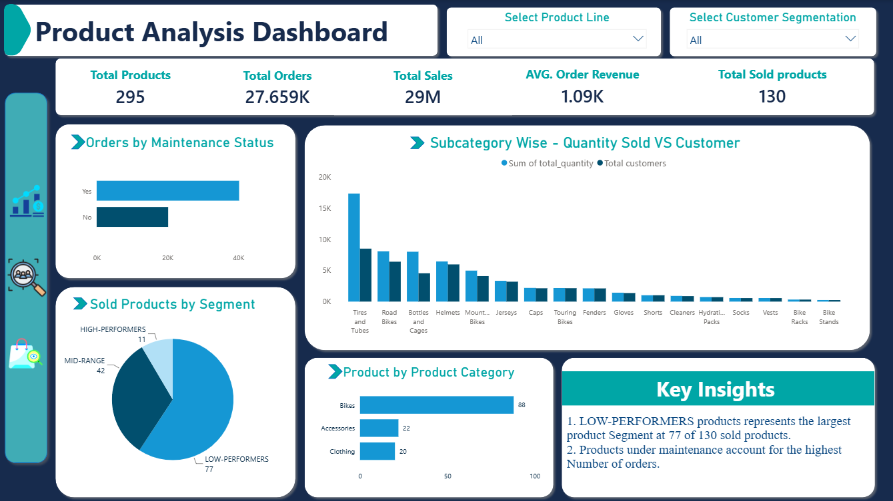

# SalesScope Analytics
#### Sales Performance , Customer Analysis and Products Insight Using SQL and Power BI

## Project Overview

This project focuses on analyzing sales data using SQL to identify business trends, evaluate sales performance, and generate meaningful insights and trends. It involves data exploration, data cleaning, and the development of customer and product reports to evaluate sales performance. It uses SQL to analyze sales data, track key performance indicators such as total revenue and order volume, and evaluate sales trends across products and time periods. A power BI dashboard is created to visualize key performance indicators and present the findings through interactive charts and visulizaation.

## Business Problem</h2>

The business needs to evaluate its sales performance to understand how revenue and order volumes change over time, which products contribute the most to overall sales, and where sales performance can be improved. Without a structured analysis, identifying sales trends and underperforming areas can be challenging.

## Tools & Technologies
- SQL
- Power BI (Dashboard Visualization)
- GitHub (Project Documentation)

## Key Analysis

- Exploratory Data Analysis (EDA)
- Customer Analysis
- Product Analysis
- Basic and Advanced SQL Queries
- Sales Performance Analysis

## Technical Skills Demonstrated

### SQL

- Data Exploration and Analysis
- Joins, Aggregations, and Subqueries
- Common Table Expressions (CTEs), including Nested CTEs
- Window Functions
- Date Functions
- Customer and Product Reporting

### Power BI

- SQL Server Data Connectivity
- Data Cleaning and Transformation using Power Query
- Data Modeling and Relationships
- DAX Measures and KPI Cards
- Interactive Slicers and Dynamic Filtering
- Data Visualization and Dashboard Design

## Dashboard Preview 
### 1.Sales Performance Dashboard

#### Key Insights
- Total sales reached approximately 29M.
- Repeat customers account for around 37.14% of customers.
- Sales performance can be explored across product categories, regions, and customer segments.
- United States contribute the highest sale , making it a key market for the business.

### 2.Customer Analysis Dashboard

### Key Insights
- The dashboard tracks approximately 18.48K customers.
- Average monthly spend is approximately 452.78.
- Customer patterns can be compared across age groups, countries, segments, and gender.
- Average monthly Spending of customer is approximately 453.

### 3.Product Analysis Dashboard

#### Key Insights
- 130 distinct products appear in the sales transactions.
- Products are classified into High, Mid, and Low performer groups.
- Subcategory-level comparisons help evaluate quantity sold and customer reach.
- Customers generate higher sales from products with maintenance. 

### Dynamic Insights

- <b> Sales Performance </b>: The dashboard dynamically highlights sales performance across customer segment and Product category. 
- <b> Customer Analysis </b>: The dashboard updates customer related insights based on customer gender and product Category.
- <b> Product Analysis </b>: The dashboard provides filter-responsive insights into product performance, maintenance status, and subcategory-level sales patterns.

These dynamic insights are powered by DAX measures in Power BI and respond to report filters and slicers selections, enabling interactive data exploration.

## Project Structure

- Scripts – SQL queries for data exploration, analysis, and reporting.
- Dashboard – Power BI Dashboard file (.pbix) .
- Screenshots – Dashboard screenshots for project preview.
- README.md - Project documentation.

## How to Explore the Project

- View the dashboard screenshots to explore the report pages.
- Download the Power BI (.pbix) file and open it in Power BI Desktop to interact with the dashboards.
- Review the SQL scripts to understand the data analysis process.

## Related Project

This project is connected to my SQL Data Warehouse project, which focuses on preparing and organizing data for analysis.

🔗 **SQL Data Warehouse:** [View Repository](https://github.com/bhumika-madaan/SQL-DATA-WAREHOUSE-PROJECT)
